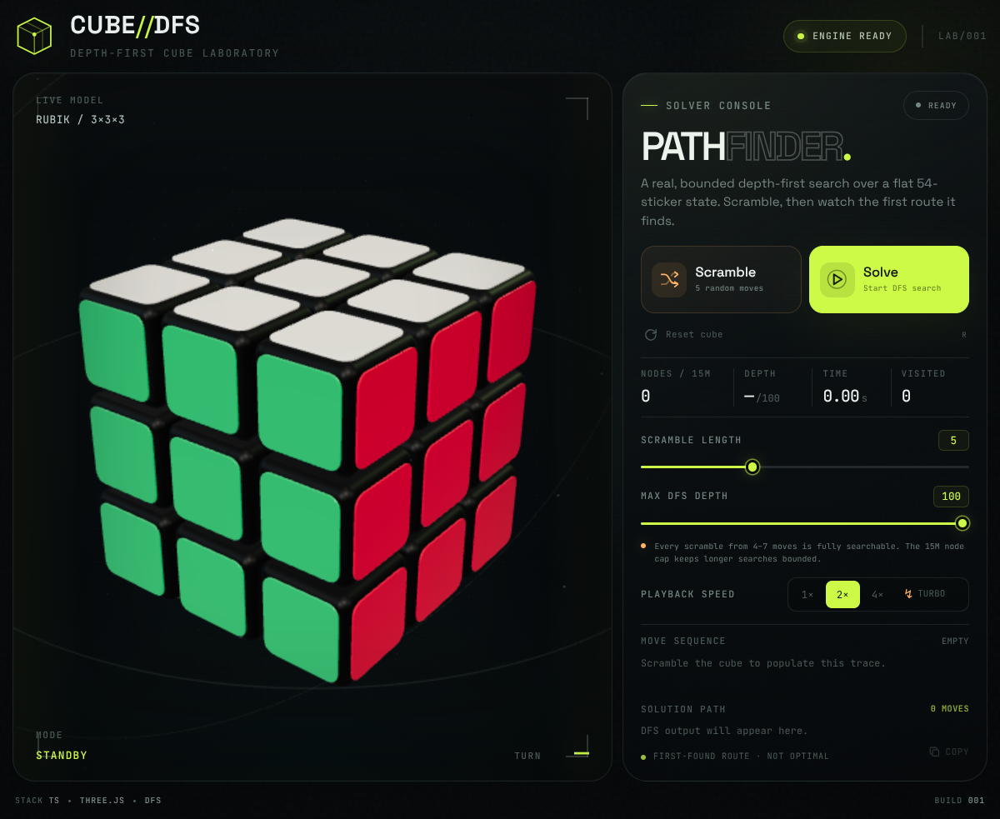

# CUBE//DFS

An interactive, single-screen 3D Rubik's Cube lab driven by a real
depth-limited depth-first search.

The 3D cube is rendered with **Three.js / WebGL**. The logical puzzle is a flat
**6 × 9 = 54-sticker** array. Movement, search, and animation are deliberately
decoupled: the solver works only on the sticker array, while the scene animates
the matching face turns with easing.



*The Pathfinder console stays pinned beside the cube on desktop and compact
desktop layouts.*


*A completed run: the scramble, first-found solution, node count, bound, visited
states, and search time all remain visible.*

## Quick start

```bash
npm install
npm run dev      # http://localhost:5173
npm run build    # type-check + production build
npm test         # Vitest suite
npm run preview  # serve the production build
```

Built with TypeScript, Three.js, Vite, and Vitest.

## Controls

| Control | Behavior |
| --- | --- |
| **Scramble** (`S`) | Resets to solved, then applies an animated random scramble. |
| **Solve** (`Enter`) | Runs the DFS and animates the first solution it finds. |
| **Reset** (`R`) | Restores the solved state and clears the current trace. |
| **Playback speed** | `1×`, `2×`, `4×`, or `Turbo` — animation pacing only. |
| **Orbit** | Drag to rotate, scroll to zoom, right-drag to pan. |

The Pathfinder console exposes the scramble length (`4–7`), maximum DFS depth
(`3–100`, default `100`), live node count, current bound, elapsed search time,
and visited-state count. The run shares a **15,000,000-node cap**. A `Stop`
button replaces `Solve` while a run is active.

## How the demo works

The default scramble is **5 moves**, which leaves enough room for the browser
worker to search to completion and animate the solution. The full slider range is
4–7 moves, all within the intended demo-scale DFS.

The solver runs iterative deepening up to the configured depth bound:

1. Try a strictly shallower bound first.
2. Run a real depth-limited DFS at the next bound.
3. Return the **first** path that reaches the solved state.
4. Keep the UI responsive by doing all search in a Web Worker.

A 7-move search is the expensive case and can take tens of seconds on slower
hardware. If a run spends its node or time budget before finding a route, the
console reports `SEARCH CAPPED` instead of inventing a solution. Search results
are always verified against the logical 54-sticker state before playback.

## Solver details

- 18 standard moves: `U U' U2 D D' D2 L L' L2 R R' R2 F F' F2 B B' B2`.
- Facelet order: `U, R, F, D, L, B`, row-major per face.
- Move permutations are generated from the actual 3D sticker geometry, keeping
  the logical model and the Three.js representation on one convention.
- DFS applies moves in place with permutation cycles and undoes them on
  backtrack. The recursion stack is O(depth).
- Pruning:
  - immediate inverse / same-face repeats,
  - a repeated face within the last two plies,
  - adjacent opposite faces.
- Scrambles are genuine random sequences with no hidden solution and no
  cancellation padding. The generator mirrors the pruning contract, so a legal
  inverse route always exists in the searched tree; the solver is never handed
  that route.
- Transpositions use a compact 27-character base64 state key. Because legal
  moves also depend on the previous two faces, those faces are part of the key.
  The visited map is bounded by the run budget; the DFS stack itself remains
  O(depth).
- Both the search and the animation can be stopped cleanly. Reset during a
  search terminates the worker and restores the solved cube.

## Why a bounded DFS?

A naive DFS can be memory-light and simple, but the number of move sequences
grows exponentially. This project makes that trade-off visible instead of
pretending a deep cube can always be solved quickly in a browser:

- 4–7 move scrambles are the supported demo range.
- The node cap prevents a deep search from consuming the tab indefinitely.
- Metrics update live so the cost is explicit.
- The solution playback shows exactly what the search returned.

The rendering path is also budget-conscious: demand-driven WebGL rendering
(nothing is drawn while idle), no auto-rotation, no large CSS backdrop blurs, a
capped device pixel ratio, and standard PBR materials. That keeps the cube and
camera interaction smooth while the worker is busy.

## Project layout

```
src/
  cube/
    CubeState.ts      flat 54-sticker model, geometry-derived permutations
    scramble.ts       genuine random Singmaster scrambles
    CubeView.ts       Three.js scene, easing, OrbitControls, responsive camera
  solver/
    dfs.ts            in-place cycle DFS, pruning, progress, budgets
    dfs.worker.ts     Web Worker entry
    workerClient.ts   attempt orchestration and cancellation
    protocol.ts       worker message types
  solver-tests/
    cube.test.ts      model, scramble, and solver coverage
  main.ts             app shell, controls, metrics, interaction flow
  styles.css           single-page application styling

docs/screenshots/     README captures
public/               favicon + web app manifest
```

## Tests

`npm test` covers:

- facelet geometry mapping and permutation bijectivity,
- move/inverse and sequence round-trips,
- compact state keys,
- genuine full-length scrambles with no precomputed solution,
- the generator's pruning-contract constraints,
- complete solves of short states,
- honest budget termination on deep bounds,
- validity of returned paths.
