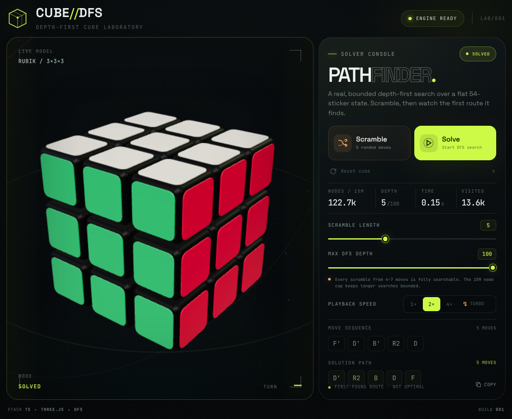

# CUBE//DFS

An interactive, single-screen 3D Rubik's Cube lab driven by a real
depth-limited depth-first search.

The 3D cube is rendered with **Three.js / WebGL**. The logical puzzle is a flat
**6 × 9 = 54 sticker** array. Movement, search, and animation are deliberately
decoupled.


*The Pathfinder console stays pinned beside the cube. The default 5-move
scramble is small enough for the bounded DFS to search to completion.*



*A completed run: the scramble, first-found solution, node count, bound, visited
states, and search time all remain visible.*

```bash
npm install
npm run dev      # http://localhost:5173
npm run build
npm test
```

## What's on screen

- 26 rounded black cubelets with glossy, rounded stickers.
- OrbitControls: drag to orbit, scroll to zoom, right-drag to pan.
- Smooth 90°/180° face turns with cubic easing.
- A Pathfinder console pinned beside the cube on desktop and compact desktop
  layouts: scramble length, maximum DFS depth (default 100, up to 100), playback
  speed (1×, 2×, 4×, Turbo), node count, current bound, visited states, and
  elapsed search time.
- Full Singmaster notation for both the scramble and the found solution.
- Reset, keyboard shortcuts (`S`, `R`, `Enter`), and copy-to-clipboard for the
  solution.
- A single app page with an installable web manifest — no marketing pages or
  navigation.

The default scramble length is **5 moves** so a first run demonstrates the full
solve animation. The slider covers 4–7 moves. Those bounds are small enough for
the DFS to search to completion inside the 15,000,000-node run budget — a
7-move solution can take several seconds of real search time. If a run cannot
finish under its budget, the console reports `SEARCH CAPPED` rather than
inventing a route.

## Solving

The solver is a genuine bounded DFS:

- Scrambles are real random move sequences. There is no hidden solution and no
  cancellation padding.
- Iterative deepening first probes bounds 1–8. Above 12, deeper bounds are
  sampled (`26, 45, 63, 82, 100`) so the browser does not spend minutes on
  obviously intractable attempts. Every attempt is still a real DFS.
- Scrambles of 4–7 moves fit inside the configured search budgets and solve
  with a visible move-by-move animation. The 7-move bound is the expensive one
  and may spend several seconds in the worker.
- The scramble generator mirrors the solver's pruning (no same face within two
  plies and no adjacent opposite faces), so a legal inverse route always exists
  in the searched tree. The solver is never handed that route.

## Search details

- 18 moves: `U U' U2 D D' D2 L L' L2 R R' R2 F F' F2 B B' B2`.
- Facelet order: `U, R, F, D, L, B`, row-major per face.
- Move permutations are generated from actual 3D sticker geometry, keeping the
  logical state and Three.js representation on one convention.
- DFS applies moves in place using permutation cycles and undoes them on
  backtrack, so the recursion stack is O(depth).
- Pruning: skip immediate inverses/same-face repeats, a repeated face within
  the last two plies, and adjacent opposite faces (the generator mirrors that
  contract so short scrambles always remain solvable).
- Transpositions are guarded by a compact 27-character base64 key. Because the
  legal-move set depends on the last two faces, the key includes those faces.
  The visited map is bounded by the per-attempt node cap; the DFS stack itself
  remains O(depth).
- The solver runs in a Web Worker so metrics update while the UI remains
  interactive. The entire run shares a 15,000,000-node cap. `Stop` aborts the
  current run.
- Rendering is demand-driven (no idle animation loop), auto-rotation is off,
  CSS blur layers are avoided, and device pixel ratio is capped for lower GPU
  load.

## Layout

```
src/
  cube/
    CubeState.ts      flat 54-sticker model, geometry-derived permutations
    scramble.ts       genuine random Singmaster scrambles
    CubeView.ts       Three.js scene, animations, OrbitControls
  solver/
    dfs.ts            in-place cycle DFS, pruning, progress, budgets
    dfs.worker.ts     worker entry
    workerClient.ts   attempt orchestration
    protocol.ts       worker message types
  main.ts             app shell, controls, metrics, interaction flow
  styles.css
```

## Tests

`npm test` covers:

- facelet geometry mapping and permutation bijectivity,
- move/inverse and sequence round-trips,
- compact state keys,
- genuine full-length scrambles with no precomputed solution,
- complete solves of short states,
- budget termination on deep bounds,
- pruning-contract validity of returned paths.
